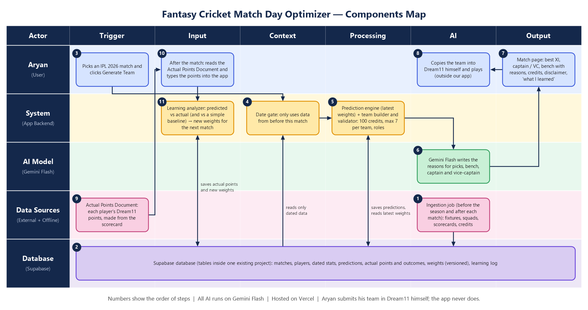

# Match Day Optimizer: IPL 2026

A Dream11 match-day agent for Aryan. Given an IPL 2026 match it builds the highest-scoring **legal** Dream11 XI, names a captain and vice-captain with reasoning specific to that match and venue, then **learns from Aryan's real points** after the match.

Built for the Mesa C4 AI Final (Hard). Live: https://ipl-match-day-optimizer.vercel.app. Case: *Fantasy Cricket Match Day Optimizer*.



## How it works

| Step | What happens | Where |
|---|---|---|
| 1. Ingest (ahead of time) | Downloads the public Cricsheet IPL archive, parses every ball, computes Dream11 points for every player in every match (1,243 matches, 27,909 player-match rows), stamps each with a match date and sequence number, loads it into Supabase. | `scripts/ingest.ts`, `src/lib/cricsheet.ts`, `src/lib/dream11.ts` |
| 2. Date gate | For match *N* the database is queried for rows with `seq < N` only. The engine then **asserts** it, and throws if any evidence is not strictly older. | `src/lib/db.ts` (`loadEvidence`), `src/lib/engine.ts` (`assertDateGate`) |
| 3. Predict | Predicted points = weighted blend of five evidence factors (recent form, career average, record at this ground, record vs this opponent, role baseline) × role and ground-type multipliers. **Code computes this; the model never produces a score.** | `src/lib/engine.ts` |
| 4. Build the team | Exhaustive branch-and-bound over the match's players for the maximum expected points (with 2x captain / 1.5x vice-captain) under every Dream11 rule; an independent validator re-checks the result before anything is shown. | `src/lib/optimizer.ts` |
| 5. Explain | Gemini Flash writes the match- and venue-specific reasoning from the engine's numbers, with strict "use only these facts" instructions, schema validation, and a deterministic fallback so a failed call never breaks a recommendation. | `src/lib/gemini.ts` |
| 6. Store predictions | Every pool player's predicted score (selected or not), its factor values and the weights version are saved. | `md_predictions`, `md_recommendations` |
| 7. Aryan plays, enters actuals | After the match he types each of his 11 players' actual Dream11 points (plain points; the app applies the multipliers). | `md_actuals`, `src/components/ActualsForm.tsx` |
| 8. Learn | Compares predicted vs actual, against a naive "career average" baseline, finds recurring errors by factor, player type and ground type, and updates the weights in **small, capped steps**, and only with enough evidence (at least 22 entries overall, at least 6 per bucket). Each change is versioned and explained in plain language. | `src/lib/learning.ts`, `md_weights`, `md_learning_log` |

## Understanding the points (and their ceiling)

Every number in the app is **Dream11 points for one player in one match**. The app shows this scale on the home page, on every match page and on the **Points guide** page, so a score like "68" always has context.

| | Dream11 points |
|---|---|
| Lowest ever (IPL 2008-2025) | -4 |
| Typical player-match (median) | 30 |
| Top 10% start at | 86 |
| Top 1% start at | 143 |
| **Highest ever** | **306** (Chris Gayle, 175 off 66 balls and 2 wickets, 2013) |

Measured over all 26,137 IPL player-matches from 2008 to 2025 (the 2026 season is never included, because in the app's timeline it has not been played yet), scored with the T20 table in `src/lib/dream11.ts`. Only about 0.7% of player-matches ever pass 150.

**Is there a ceiling?**
1. **Actual points: no cap in the rules**, but a practical limit: nobody has passed 306. A captain counts 2x, a vice-captain 1.5x.
2. **Predicted points: an average, so far below the peaks.** A prediction is a weighted average of a player's past points (form, career, this ground, this opponent, role) times small multipliers capped at 0.8 to 1.2. It cannot reach peak scores. In back-testing, the agent's predictions ran about **14 to 76 per player**.
3. **A whole XI** (11 predictions plus the captain's extra 1x and the vice-captain's extra 0.5x) came to about **441 to 623**, averaging about 520.

The agent is judged by how the gap between predicted and actual points behaves match after match, next to a simple "career average" baseline, not by whether it predicts peak days. Each predicted score in the app is also drawn as a bar against the IPL record.

`npm run points-scale` recomputes the scale and the record holders into the database; `npm run entry-sheets` rebuilds the Excel entry workbook and the prediction range.

### Season stars and team logos (you supply the images)
The home page shows the **stars of IPL 2025** (the last completed season): Abhishek Sharma (best batting day, 201), Mitchell Starc (bowling, 145), Sunil Narine (all-round, 171) and Rishabh Pant (keeper, 171). Put portrait or square photos (about 600px or larger) in `public/players/` named `abhishek-sharma`, `starc`, `narine`, `pant` with a `.jpg`, `.png`, `.jpeg` or `.webp` extension. Team logos go in `public/teams/` as `CSK.png`, `MI.png`, `RCB.png`, `KKR.png`, `SRH.png`, `DC.png`, `RR.png`, `PBKS.png`, `GT.png`, `LSG.png`. Until a file exists the app shows an icon or a large colour crest. Official logos are trademarks and photos have owners: make sure you may use anything you add.

### The season is played in order
Match N opens only after Match N-1 has been played through the app (generated, then its real points entered), because the agent needs what it learned. This is enforced on the server (HTTP 423 Locked) as well as in the UI, so a later match cannot be generated by accident or by URL.

### The evidence / weights split
- **Evidence** (form, venue, opponent records, earlier results) is anything dated before the match. This is how a match-8 prediction knows about match 1-7.
- **Weights** (how much each kind of evidence counts) change only from Aryan's entered points vs the agent's own predictions.

Gemini does **not** learn. What changes between matches is the small set of stored weights.

### Dream11 rules enforced
11 players · 100 credits · max 7 from one team · WK 1-4, BAT 3-6, AR 1-4, BOWL 3-6 · captain 2x · vice-captain 1.5x. Defined in `src/lib/config.ts`.

## Honest limitations
- **Credits are estimated.** Dream11 credit values are not published anywhere we could use legitimately (Dream11's terms prohibit automated access), so each player's credit is estimated from past performance and labelled as an estimate everywhere. The 100-credit rule is guaranteed only against these estimates.
- **Playing group.** The pool is the players Cricsheet lists for a match (the XI plus any impact substitute used), standing in for the post-toss announced XI.
- **Player roles** are inferred from IPL history before 2026, plus a short list of known wicketkeepers; debutants are classified by Gemini Flash when it recognises them, otherwise default to batter.
- **Prediction error is large** (about 26 Dream11 points per player in an offline replay of all 74 matches) and close to a simple career-average baseline. T20 fantasy points are very noisy. What the loop reliably does is keep over/under-prediction small; the learning page shows the agent's gap next to the baseline so improvement can be judged honestly.
- **Replay.** IPL 2026 is already over, so the season is replayed match by match from real, scraped data. The date gate is what stops the replay from leaking results.
- The Dream11 scoring table in `src/lib/dream11.ts` was checked against two published guides (Sportskeeda, psainath.org) and matches them; Dream11's own points page could not be reached, so it is not confirmed against Dream11 itself. Unconfirmed: the stumping value (+12 assumed) and whether the 30/50/100-run bonuses stack (highest only assumed). It lives in one place, so a correction is a one-file change.

## Run it

```bash
npm install
cp .env.example .env.local        # fill in the values
# one-off: run supabase/schema.sql in the Supabase SQL editor
npm run ingest                     # loads Cricsheet data into Supabase
npm run classify-roles             # optional: Gemini classifies debutant roles
npm run dev
```

Environment: `NEXT_PUBLIC_SUPABASE_URL`, `SUPABASE_SERVICE_ROLE_KEY` (server only), and either `GEMINI_API_KEY` (+ `GEMINI_MODEL`) or `OPENROUTER_API_KEY` (+ `OPENROUTER_MODEL`, default `google/gemini-3.6-flash`).

### Actual Points Document
After a match, `npm run points-doc -- <match number>` (or without a number for all 74) writes a CSV in `docs/actual-points/` with every player's Dream11 points and a line-by-line breakdown, worked out from the scorecard. It is an outside-the-app convenience for the replayed season; Aryan reads his players' numbers from it and types them in. A copy for all matches is already in the repo.

### Tests
`npm run test:engine -- <cricsheet-json-dir>` replays all 74 matches offline: checks the date gate rejects same-match evidence, every team is valid, and prints accuracy against the baseline.

## Stack
Next.js 16 (App Router) · Supabase (Postgres) · Gemini Flash · Vercel · Tailwind
